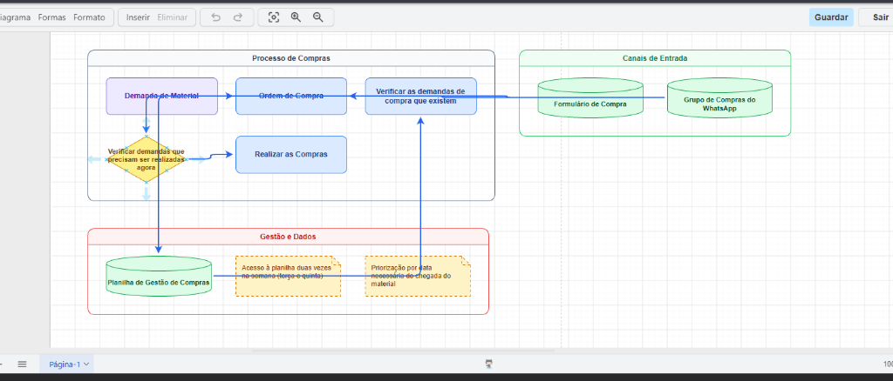

# Semblance Canvas

[](LICENSE)
[](https://www.python.org/)
[](tests/)
[](skills/text_to_semantic_json/SKILL.md)
[](KNOWN_ISSUES.md#1-automated-cicd-workflow-in-construction)

If you love visually organizing the buckets of ideas coming spontaneously from your brain, you're gonna love this. I personally struggle drawing schemas because the way I think better is both speaking AND drawing. So...

This is a local **Real-Time Speech-to-Canvas Reasoning Studio** that listens to user speech, extracts strictly asserted facts under the **Non-Invention Rule (Factual Provenance Guardrail)**, and dynamically drives an embedded [diagrams.net](https://app.diagrams.net) canvas with auto-reconciled geometry, persistent state, and interactive visual telemetry.


*Real multi-turn execution: voice/text pipeline ingesting procurement rules into the browser studio, generating visual "De-Para" taxonomy (green cylinders for data stores, yellow post-its for side notes, yellow diamond for decision gates, blue cards for workflow steps), dynamic swimlanes, and persistent session state on an embedded diagrams.net canvas.*

---

## 📖 Open Source Guidelines & Documentation

* 🤝 **Contributing Guide**: See [CONTRIBUTING.md](CONTRIBUTING.md) for local dev setup, coding conventions, and PR workflows.
* ⚠️ **Known Issues & Technical Debt**: See [KNOWN_ISSUES.md](KNOWN_ISSUES.md) for transparent tracking of known limitations, CI/CD roadmap, and open refactors.
* 📄 **License**: Permissive open-source [MIT License](LICENSE).
* 🏛️ **System Architecture**: Detailed design in [docs/ARCHITECTURE.md](docs/ARCHITECTURE.md).
* 📐 **Data Schemas & Protocols**: Schema contracts in [docs/DATA_MODELS_AND_SCHEMAS.md](docs/DATA_MODELS_AND_SCHEMAS.md).
* 🗺️ **Long-Term Milestones**: Engineering milestones in [docs/ROADMAP.md](docs/ROADMAP.md).

> [!NOTE]
> **CI/CD Automation Status**: Automated GitHub Actions workflows for continuous integration and linting are actively in construction and will be published alongside the typed semantic taxonomy milestone. The test suite currently runs locally with a 100% pass rate (10 tests passing).

---

## ⚡ Quickstart

### 1. Prerequisites & Installation
* **Python**: 3.10+ recommended.
* **Microphone (Optional)**: Modern versions of Google Chrome or Microsoft Edge natively power browser dictation via the Web Speech API. For direct local audio capture, PyAudio and PortAudio headers are supported.

```bash
git clone https://github.com/Scheuer12/semblance-canvas.git
cd semblance-canvas
pip install -r requirements.txt
```

### 2. Run Test Suite
```bash
python -m unittest discover -s tests -t .
```
*(All 10 unit tests run offline in < 0.1s without network dependencies or paid credentials).*

### 3. Start Bridge Server
```bash
python -m src.server --port 8050
```
Open **`http://127.0.0.1:8050`** in Google Chrome or Microsoft Edge. Use the **`🎙️ Ditar Voz (Mic)`** button or type directly into the test input.

---

## 🧠 AI Backend: Google Antigravity Subscription

So, since this project started as a personal problem solver, it currently works with the AI backend I had immediately available. The default backend invokes the official Antigravity CLI (`agy`) in headless mode, reusing cached Google OAuth credentials. This allows the pipeline to consume the quota associated with an active Google AI Pro/Ultra subscription without a separate pay-as-you-go Gemini Developer API key. (I mean, I was already paying for it!)

### One-Time Setup
1. Ensure the Antigravity CLI (`agy`) is available on `PATH`.
2. Run `agy` interactively once and sign in with the Google account owning the subscription.
3. Exit the interactive session. The bridge server uses a persistent resident `stream-json` daemon (`subprocess.Popen` with `CREATE_NO_WINDOW`) for low-latency multi-turn reasoning without per-turn cold-start overhead.

### Alternative Backends
* `google_genai`: Official Gemini Developer API via `GEMINI_API_KEY`.
* `gemini_cli`: Compatibility adapter for the legacy CLI.
* `mock`: Deterministic offline backend used by unit tests.

---

## ✨ Implemented Core Capabilities

1. **Strict Provenance & Non-Invention Guardrail**: Every concept node and relationship edge must trace back to explicit transcript segments (`source_ids`). Unsupported relationships are strictly rejected.
2. **Deterministic Layout & Visual "De-Para" Engine (`deterministic_layout.py`)**:
   * **Sub-5ms Execution**: Replaced the secondary 25-second LLM layout step with a deterministic Python engine calculating horizontal flows, coordinates, and container geometries in `< 5ms`.
   * **Visual Entity "De-Para" Taxonomy**: Maps semantic types directly to distinct diagrams.net shapes and colors:
     * ⚙️ `process_step` ➔ Rounded blue card (Operational Action)
     * 📝 `side_annotation` ➔ Yellow dashed sticky note (Observations / Caveats)
     * 🗄️ `data_store` ➔ Green cylinder (Databases, Spreadsheets, WhatsApp groups)
     * 🔀 `decision_gate` ➔ Yellow diamond (Approval conditions)
     * 👤 `actor` ➔ Persona figure (Departments, Stakeholders)
     * 💡 `concept` ➔ Rounded lavender card
3. **Speech Debounce & Asynchronous Queue Coalescing (4x Speedup)**:
   * **Client Debounce**: An 8-word / 1.2s silence threshold buffers short breath pauses (`"separado"`, `"então"`), keeping logical thoughts together.
   * **Server Queue Coalescing**: If speech arrives while the LLM daemon is busy, subsequent segments (`s-2`, `s-3`, ...) are queued non-blockingly and folded into a single consolidated prompt. Multi-turn dialogue turnaround dropped from **~8 minutes to 1m53s** across 8 segments.
4. **Expanded Mode B Direct Actions**:
   * Open-ended schema and state management for imperative canvas commands (`layout_reorganize`, `align`, `group`, `restyle`, etc.) enabling users to verbally command visual diagram reorganizations.
5. **Deterministic Geometric Stabilization (`mxgraph_converter.py`)**:
   * **Dynamic Bounding Boxes**: Containers mathematically enclose member nodes with safe margins (30px lateral, 45px header). Cards never overflow their swimlane.
   * **AABB Collision Buffer**: Overlapping nodes are detected and cleanly spaced downward with a 30px buffer.
   * **Arc Jump Connectors (`jumpStyle=arc`)**: Orthogonal lines that intersect display clean bridge jumps, eliminating line ambiguity.
   * **Adaptive Semantic Edge Routing**: Open relation vocabulary (`requires`, `triggers`, `delivers_to`, `depends_on`) maps dynamically to specialized line styles (dashed dependencies, blue flow triggers, diamond containment).
6. **State Mutation & Deletion Lifecycle (`session_state.py`)**:
   * Spoken commands to remove elements (e.g., *"tire o step 1"*) resolve target IDs, purge dangling edges, mark actions as `DONE`/expired, and synchronize the visual canvas via full state reload (`load`), eliminating ghost shapes.
7. **Dual-Layer Session Persistence**:
   * Auto-saves the complete graph, action history, and transcript segments to `data/session_state.json`.
   * Mirrors XML in browser `localStorage`. Refreshing the browser (**F5**) restores the entire canvas and terminal log instantly.
8. **Interactive Telemetry Semáforo & Resilient Dev Inspector**:
   * 4-stage pipeline semáforo (Audio, Semantic, Layout, Diagrams Bridge) with visual spinners, frozen error state, and zero-overflow diagnostic tooltips.
   * Real-time Semantic JSON streaming: displays raw AI output immediately upon receipt, with red error badges and commented banners if schema warnings arise.
   * Self-healing reflection loops: automatically prompts the resident AI daemon to repair minor schema violations before raising pipeline errors.
9. **Background AI Daemon Pre-warming**:
   * Proactively pre-warms the persistent resident `agy` daemon process on server boot, eliminating the first-turn cold-start latency and logging resident readiness to the Live Logs terminal.
10. **Native Browser Voice Dictation**:
    * One-click microphone toggle utilizing native Web Speech API (`pt-BR` / `en-US`), passing speech chunks into the WebSocket pipeline with continuous interim preview.

---

## 🎯 Next Steps & Architecture Roadmap

For full technical specifications and active issue tracking, refer to [`KNOWN_ISSUES.md`](KNOWN_ISSUES.md). Key milestones include:

1. **Collision Avoidance & Overlap Prevention**: Advanced orthogonal routing with obstacle avoidance and dynamic lane assignment to prevent cross-container edge-node overlaps. ([Details](KNOWN_ISSUES.md#2-collision-avoidance--long-edge-obstacle-routing))
2. **The Reverse Path (Bidirectional Canvas-to-AI Sync)**: Listening to diagrams.net `autosave` postMessage events to ingest manual canvas edits back into Python `CanvasSessionState` and provide manual layout context to the AI model. ([Details](KNOWN_ISSUES.md#3-bidirectional-canvas-sync--the-reverse-path-ui-to-ai-synchronization))
3. **Global Semantic Re-scoping**: Automatic heuristic to refactor early micro-clusters into higher-order macro-swimlanes as multi-turn dialogues unfold. ([Details](KNOWN_ISSUES.md#4-global-semantic-re-scoping--granularity-refactoring))
4. **Mixed-Intent Utterance Disambiguation**: Splitting composite sentences containing both domain facts (Mode A) and canvas layout directives (Mode B). ([Details](KNOWN_ISSUES.md#5-mixed-intent-utterance-disambiguation-mode-a-vs-mode-b))
5. **Automated CI/CD Workflow**: GitHub Actions pipeline for automated linting, schema validation, and multi-OS regression testing. ([Details](KNOWN_ISSUES.md#1-automated-cicd-workflow-in-construction))

---

## 🏛️ System Architecture Overview

```text
┌─────────────────┐
│   Microphone    │ (Browser Web Speech API / PyAudio)
└────────┬────────┘
         │ (Audio Stream / Transcribed Segments with Debounce)
         ▼
┌─────────────────────────┐
│ Semantic Interpretation │ (Skill 1: Mode A: Ideas | Mode B: Direction)
│  & Provenance Validator │ [Enforces Non-Invention Rule via Schema Validation]
└────────┬────────────────┘
         │ Semantic JSON IR (Concepts, Typed Entities, Explicit Edges)
         ▼
┌─────────────────────────┐
│ Deterministic Layout &  │ (Deterministic Visual "De-Para" Engine < 5ms)
│  mxGraph Serializer     │ [Entity Taxonomy, Dynamic Swimlanes, Arc Jumps]
└────────┬────────────────┘
         │ mxGraph Model XML
         ▼
┌─────────────────────────┐
│   JavaScript Bridge     │ (FastAPI WebSocket Server with Queue Coalescing)
└────────┬────────────────┘
         │ postMessage API (action: 'load', autosave: 1)
         ▼
┌─────────────────────────┐
│ diagrams.net (Embedded) │ [Interactive, Fully Editable Visual Canvas]
└─────────────────────────┘
```

---

## 🔄 Two Core Processing Modes

### Mode A: Ideas Design
- **Objective**: Ingest user thoughts, identify explicit concepts, and place them on the canvas.
- **Visual Spatial Proximity vs. Relationships**:
  - Concepts sharing semantic context may be positioned close to each other.
  - **No edge (dependency, causality, hierarchy, sequence, or ownership) is created unless explicitly spoken by the user.**
- **Provenance**: Every node and relationship links back to its exact transcript source IDs (`source_ids`).

### Mode B: Diagram Direction
- **Objective**: Execute direct structural or layout instructions (e.g., *"Put these closer"*, *"X depends on Y"*, *"Create an Ishikawa for this problem"*).
- **Templates & Standards**: Recognized frameworks (e.g., Ishikawa 6M: *Man, Machine, Method, Material, Measurement, Mother Nature*) may supply structural scaffolding labels, but leaves/causes remain empty placeholders unless explicitly provided by the user.

---

## 🚫 The Non-Invention Rule

Every factual entity in the diagram must maintain verifiable provenance:
- **Concept Node**: Must track the `source_ids` from which it was extracted.
- **Relationship Edge**: Must track the `source_ids` asserting the connection. If unsupported, the relationship is forbidden.

---

## 📚 Documentation - Deepdive the project structure

- 🏛️ [Project Architecture & System Design](docs/ARCHITECTURE.md)
- 📐 [Data Models, Schemas & Protocols](docs/DATA_MODELS_AND_SCHEMAS.md)
- 🗺️ [Implementation Roadmap & Milestones](docs/ROADMAP.md)
- ⚠️ [Known Issues & Technical Debt](KNOWN_ISSUES.md)
- 🤝 [Contributing Guide](CONTRIBUTING.md)

---

## ⚡ Current Status
The Python real-time bridge server (`src.server`), persistent headless `agy` CLI daemon (`stream-json`), diagrams.net embedded iframe, non-invention verification suite, deterministic layout engine (< 5ms), typed entity De-Para taxonomy, client-server speech coalescing, intelligent 4-stage pipeline semáforo, interactive Dev Tab inspector, and session-state deletion lifecycle are fully implemented and running locally with a 100% offline test pass rate (10/10 tests passing).
