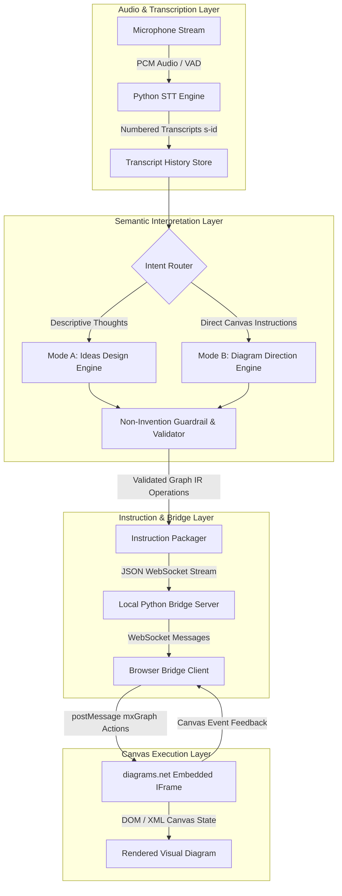

# Architecture Specification: Semblance Canvas

## 1. Overview & Architectural Goals

Semblance Canvas is designed as a near real-time, voice-driven diagramming interface. It translates spoken stream inputs into precise graphical modifications on an embedded [diagrams.net](https://app.diagrams.net) canvas.

### Guiding Principles
1. **Zero Hallucination / Non-Invention**: The AI never asserts domain relationships or concepts not explicitly stated.
2. **Deterministic Provenance**: Every generated node and edge has explicit lineage back to speech transcript segments (`s-1`, `s-2`, etc.).
3. **Proximity ≠ Relationship**: Semantic closeness controls coordinate layout clustering only, never generating semantic graph edges.
4. **Separation of Concerns**: Strict boundary between voice ingestion, semantic interpretation, graph IR generation, and diagram rendering.

---

## 2. End-to-End Pipeline



### 2.1 AI connectivity

The default semantic backend is `AntigravityCliClient`. For every semantic operation it starts `agy` in official headless print mode, submits the combined skill instructions and user payload, reads the response from `stdout`, and validates the returned JSON locally.

Authentication is intentionally external to the application: the operator signs in once through an interactive `agy` session. Antigravity stores the OAuth credential in the system credential store and headless calls reuse it. The application never reads, copies, or persists that OAuth token.

API-key environment variables are removed from the Antigravity child process to ensure requests use the authenticated Google AI subscription. The `google_genai` backend remains available when separately billed Gemini Developer API access is desired.

```text
SkillRunner -> AntigravityCliClient -> agy --print -> Google OAuth subscription
            <- validated JSON      <- stdout
```

Security boundary: slash-command expansion is disabled for headless prompts. Model output remains untrusted and must pass JSON Schema and provenance validation before reaching the canvas layer.

---

## 3. Subsystem Breakdown

### 3.1 Audio Capture & STT (Speech-to-Text)
- **Audio Capture**: Utilizes low-latency audio capture via Python (`sounddevice` or `pyaudio`) combined with Voice Activity Detection (VAD, e.g., Silero VAD) to segment utterances cleanly.
- **STT Processing**:
  - Primary target: Local STT (e.g., `faster-whisper` on GPU/CPU) to maintain privacy and near real-time performance.
  - Optional fallback: Streaming STT APIs if configured.
- **Transcript Indexing**:
  - Each emitted utterance is assigned an immutable monotonic ID: `s-<counter>` (e.g., `s-1`, `s-2`).
  - Metadata retained: `id`, `text`, `timestamp_start`, `timestamp_end`, `confidence`.

### 3.2 Semantic Interpretation & Non-Invention Validator
The semantic layer operates in two distinct modes:

#### Mode A — Ideas Design
- **Task**: Extract factual concepts and stated connections from the stream.
- **Rules**:
  - Extract concepts as visual nodes with `source_ids = ["s-n"]`.
  - Calculate embedding/semantic vectors for layout clustering (visual coordinates $(x, y)$ proximity).
  - **Do NOT** connect nodes with edges based on semantic similarity. Only explicit statements (e.g., *"A causes B"*, *"X is part of Y"*) generate edges.

#### Mode B — Diagram Direction
- **Task**: Interpret direct imperative editing commands.
- **Examples**:
  - *"Group these three into a box titled Architecture"*
  - *"Place step 2 to the right of step 1"*
  - *"Generate an Ishikawa diagram for this issue"*
- **Structural Templates**:
  - Predefined diagram frameworks (Ishikawa/Fishbone, Mind Map, Flowchart, Venn diagram) may populate structural branches (e.g., the 6M categories: *Man, Machine, Method, Material, Measurement, Mother Nature*).
  - Leaf cause nodes remain explicit placeholders until the user provides facts.

#### Non-Invention Guardrail
- Acts as a verification pass before emitting canvas instructions.
- Checks:
  1. Does any new concept node lack an associated `source_ids` entry?
  2. Does any directed or undirected edge assert a relationship without an explicit citation from speech?
  3. If validation fails, reject the mutation and log a provenance warning.

### 3.3 Instruction Packager & Graph IR (Intermediate Representation)
- Normalizes canvas operations into a deterministic schema (see [DATA_MODELS_AND_SCHEMAS.md](file:///docs/DATA_MODELS_AND_SCHEMAS.md)).
- Dispatches granular atomic operations:
  - `ADD_NODE`
  - `UPDATE_NODE`
  - `REMOVE_NODE`
  - `ADD_EDGE`
  - `REMOVE_EDGE`
  - `MOVE_NODE` / `CLUSTER_NODES`
  - `APPLY_TEMPLATE`

### 3.4 JavaScript Bridge & diagrams.net Embedded Integration
- **Host Web Application**: A lightweight web application (served locally) housing an embedded `<iframe>` pointing to `https://app.diagrams.net/?embed=1&proto=json&configure=1`.
- **IFrame Protocol**:
  - Communication is conducted via `window.postMessage`.
  - Common diagrams.net message actions utilized:
    - `load`: Initial diagram XML / mxGraph load.
    - `merge`: Incrementally merge XML elements into the existing canvas without clearing the document.
    - `configure`: Disable unwanted UI panels for a distraction-free experience.
- **Bridge WebSocket Client**:
  - Subscribes to the Python backend's instruction stream.
  - Translates Graph IR payloads into `mxGraph` XML snippets or native diagrams.net actions.
  - Tracks canvas element mappings between Semblance `node-id` and diagrams.net `cell id`.

---

## 4. Latency & Interaction Design

| Stage | Target Latency | Notes |
| :--- | :--- | :--- |
| Audio VAD & Chunking | ~100–300 ms | Triggers after speech silence boundary |
| Speech-to-Text | ~200–500 ms | Dependent on whisper model size (`tiny.en` / `base.en` / `small.en`) |
| Semantic Interpretation | ~400–1000 ms | LLM/parser structured output generation |
| Canvas Bridge & Render | ~50–100 ms | WebSocket message delivery and `postMessage` canvas update |
| **Total Turnaround** | **< 1.5 – 2.0 s** | Near real-time visual feedback loop |

The latency table is a target, not a measured result. The current Antigravity adapter starts a process per model call and has not yet demonstrated the semantic-layer target. A persistent `stream-json` process should be implemented and benchmarked before claiming near-real-time performance.

---

## 5. Security & Boundary Architecture
- **Offline / Local Default**: Audio processing and state management execute entirely locally.
- **No Autonomous Agency**: The canvas is never updated speculatively. If speech input is ambiguous or absent, the canvas state remains untouched.
