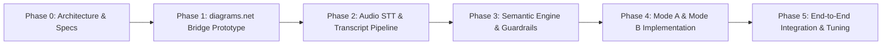

# Project Roadmap & Implementation Milestones

This document outlines the phased implementation plan for **Semblance Canvas**.

---

## 📅 Roadmap Overview

---

## Phase 0: Architecture & Specifications (Current Phase - Completed)
- [x] Document project objectives, core constraints, and non-invention rules.
- [x] Define end-to-end architecture (Python STT → Semantic Layer → Bridge → diagrams.net).
- [x] Formulate JSON schemas for transcript segments, Graph IR, and instruction packages.
- [x] Specify diagrams.net `postMessage` interface protocols.

---

## Phase 1: diagrams.net Local Bridge Prototype
> **Objective**: Validate the canvas control bridge before integrating speech or LLMs.

### Tasks:
1. **Local Host Web App**:
   - Create a lightweight local frontend (vanilla JS / Vite) that embeds `https://app.diagrams.net/?embed=1&proto=json`.
   - Implement the `init` handshake and listen for diagrams.net events.
2. **Bridge Controller (`postMessage` wrapper)**:
   - Implement programmatic generation of `mxGraph` XML snippets from high-level instructions:
     - Add concept box (vertex) with ID, label, and coordinates $(x, y)$.
     - Add directed edge between vertices.
     - Group/cluster nodes visually.
   - Dispatch `merge` actions to mutate the active canvas without wiping existing work.
3. **Mock Command Test Harness**:
   - Create a basic UI or test script injecting mock JSON `InstructionPackage` payloads to verify canvas updates.

---

## Phase 2: Audio STT & Transcript Pipeline
> **Objective**: Stream voice from microphone to clean, segmented, timestamped transcripts with immutable IDs.

### Tasks:
1. **Microphone Capture & VAD**:
   - Build a Python audio listener using `sounddevice` / `pyaudio`.
   - Incorporate Voice Activity Detection (e.g., `silero-vad`) to detect speech boundaries.
2. **STT Transcriber**:
   - Integrate local Whisper (`faster-whisper` or PyTorch Whisper) for low-latency transcription.
3. **Transcript Store & Provenance Registry**:
   - Maintain a session log assigning each utterance an immutable ID (`s-1`, `s-2`, ...).
   - Emit transcript events over local WebSocket.

---

## Phase 3: Semantic Engine & Non-Invention Guardrail
> **Objective**: Parse spoken transcripts into Graph IR operations while mathematically preventing hallucinations.

### Tasks:
0. **AI Connectivity**:
   - [x] Add an Antigravity headless adapter using cached Google OAuth subscription credentials.
   - [x] Keep Gemini Developer API and deterministic mock backends as explicit alternatives.
   - [ ] Replace per-call process startup with a persistent `stream-json` session and benchmark latency/quota use.
1. **Intent Classification & Routing**:
   - Differentiate between **Mode A** (Ideas / Information) and **Mode B** (Diagram Directives).
2. **Mode A Concept & Relationship Extraction**:
   - Extract concepts with explicit textual references.
   - Separate semantic proximity from relationships: calculate spatial coordinates $(x, y)$ for clustering, but **never** emit an edge unless an explicit dependency/causality was stated.
3. **Mode B Command Parsing**:
   - Translate direct edits (*"move X to right"*, *"group A and B"*, *"step 2 depends on step 1"*).
   - Provide standard structural skeletons (e.g., Ishikawa 6M branches) with empty placeholder leaves.
4. **Non-Invention Guardrail (Validator)**:
   - Programmatic verification layer ensuring all nodes and edges have valid, non-empty `source_ids`.
   - Reject ungrounded claims before they reach the canvas bridge.

---

## Phase 4: Mode A & Mode B Feature Completion
> **Objective**: Refine visual layout heuristics and template libraries.

### Tasks:
1. **Layout & Coordinate Engine**:
   - Implement 2D spatial clustering based on concept similarity (e.g., force-directed layout or grid placement).
2. **Structural Template Engine**:
   - Ishikawa 6M diagram generator.
   - Mind Map generator.
   - Sequence/Process flow template generator.
3. **Provenance Inspector UI (Optional Visual Overlay)**:
   - Allow clicking a node in the bridge view to highlight the exact transcript segment (`s-n`) that created it.

---

## Phase 5: End-to-End Integration & Tuning
> **Objective**: Achieve low latency, seamless synchronization, and robust error recovery.

### Tasks:
1. Connect Python STT + Semantic layer + WebSocket server + Browser Bridge.
2. Benchmark and tune end-to-end turnaround latency (target: < 1.5 seconds from speech completion to canvas render).
3. Validate against edge cases: rapid speech, correction commands (*"no, I meant X"*), canvas resize, and reconnects.

---

## 🛠️ Prerequisites & Dependencies Summary

### System & Environment Requirements
- **OS**: Windows, macOS, or Linux.
- **Python**: Version 3.10+ (for backend STT, audio capture, semantic server).
- **Node.js**: Version 18+ (for local bridge host app / Vite).
- **Audio Device**: Functional microphone input.
- **GPU (Optional but recommended)**: CUDA-enabled GPU for local `faster-whisper` acceleration.

### Python Libraries (Planned)
- `sounddevice` or `pyaudio` (microphone audio streaming)
- `faster-whisper` (speech-to-text inference)
- `silero-vad` (voice activity detection)
- `fastapi` & `uvicorn` / `websockets` (local bridge server)
- `pydantic` (schema validation & provenance enforcement)

### Frontend Libraries (Planned)
- Standard HTML5 / TypeScript or vanilla JS
- diagrams.net embedded iframe API
- WebSocket client
